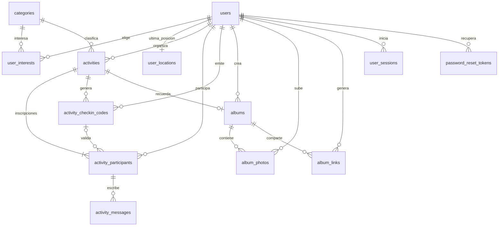

# Base de datos propuesta de SinFiltro

**13 tablas: PostgreSQL + PostGIS.** Registro abierto con cualquier correo válido. Sin universidad, campus ni mascotas. Flujo: cuenta e intereses → mapa → inscripción y chat → PIN compartido del evento → álbumes y consulta de recuerdos por distancia.

Estado: registro, login con roles y personalización de perfil implementados usando `users`, `categories` y `user_interests`. El resto del modelo social sigue pendiente de integrar con endpoints/pantallas. El único esquema de instalación es [schema.sql](schema.sql): ejecutarlo completo una sola vez en Query Tool de pgAdmin, sobre una **base nueva y vacía** con PostGIS disponible. Crea las 13 tablas y cuatro intereses iniciales, sin cuentas precargadas ni importación de datos anteriores. `queries.sql` contiene consultas parametrizadas para futuras funciones; no es un script de instalación.

`users` se crea directamente con todos sus atributos, incluido `role`. Los dos `ALTER TABLE` del esquema únicamente añaden claves foráneas entre actividades, participantes y códigos, una vez creadas esas tablas; la relación circular actividad/organizador requiere declarar una FK después. No modifican usuarios ni migran una base antigua.

`users.role` admite `user` y `admin`, con `user` por defecto. El registro público siempre crea usuarios normales; la promoción a administrador se hace desde el servidor con `npm run set-admin -- correo@ejemplo.com`. La API devuelve rol y perfil, y comprueba el rol actual al autorizar. El perfil guarda nombre, biografía e intereses en una transacción; exige al menos dos intereses activos. `avatar_storage_key` permanece reservado para una futura subida de fotos. El rol global de administrador es distinto del organizador de un evento.

## 1. Lugar y actividad

Se elimina `places`: ahora el producto necesita saber **dónde ocurrió cada evento**, sin administrar un directorio de locales, propietarios, horarios o reservas. Cada fila de `activities` conserva su propio lugar:

| Campo | Ejemplo |
| --- | --- |
| `title` | Vóley del sábado |
| `location_name` | Parque Central — Cancha 2 |
| `address` | Av. Ejemplo 123 |
| `meeting_details` | Ingreso por la puerta norte |
| `location` | Punto PostGIS con longitud/latitud |
| `starts_at`, `ends_at`, `time_zone` | Horario del encuentro y zona de presentación |

“Vóley del sábado” y “Vóley del domingo” son dos actividades aunque repitan lugar y coordenadas. Cada una tiene participantes, PIN y álbum propios. Buscar por distancia utiliza **la posición del evento**, no la ubicación actual de su organizador ni la de cada foto.

El backend permitirá editar lugar/horario antes del inicio y los congelará al comenzar para conservar la ubicación histórica. Correcciones posteriores requerirían un proceso explícito. Si más adelante se crea un directorio de locales, puede añadirse un `place_id` opcional manteniendo esta copia histórica en el evento.

## 2. Tablas y claves

Identificadores BIGINT identity salvo los códigos de asistencia (UUID) y tablas con clave compuesta. La API conserva BIGINT como texto.

| Tabla | PK | Contenido y relaciones |
| --- | --- | --- |
| `users` | `id` | Email único, hash de contraseña, nombre, biografía, rol (`user/admin`), avatar y estado. Sin restricción de dominio académico. |
| `categories` | `id` | Catálogo compartido de intereses y categorías de eventos. |
| `user_interests` | `(user_id, category_id)` | N:M usuarios/categorías; evita intereses duplicados. |
| `user_locations` | `user_id` | 0..1 última posición por usuario, precisión, expiración y consentimiento para futuro radar. |
| `activities` | `id` | FK organizador y categoría, ubicación propia, fechas, precio, cupo, estado y borrado lógico. |
| `activity_participants` | `(activity_id, user_id)` | Inscripción, presentación, última lectura del chat, validación/revocación de asistencia y límites de intentos PIN. |
| `activity_checkin_codes` | `id` UUID | FK actividad y emisor; HMAC del PIN compartido, vigencia y revocación. Conserva generaciones anteriores. |
| `activity_messages` | `id` | FK compuesta a participante del evento; texto y un adjunto opcional. |
| `albums` | `id` | FK actividad UNIQUE: máximo un álbum por evento; creador, título, visibilidad y borrado lógico. |
| `album_photos` | `id` | FK álbum y autor; clave de archivo, descripción y borrado lógico. Hereda visibilidad del álbum. |
| `album_links` | `id` | FK álbum y creador; hash del token largo para QR, vencimiento y revocación. |
| `user_sessions` | `id` | FK usuario; hash de token de sesión, vencimiento y revocación. |
| `password_reset_tokens` | `id` | FK usuario; hash del token de recuperación, vencimiento y uso único. |

Una inscripción por persona/evento evita duplicados. El organizador también tiene una inscripción: crear ambas filas en la misma transacción, como exige la FK diferida. El cupo incluye al organizador. No se duplica el rol organizador en participantes: se obtiene de `activities.organizer_id`.

## 3. Relaciones

La FK `(activity_id, attendance_code_id)` impide usar un código de otro evento. Cada participante conserva la generación que validó; muchos pueden validar el mismo código. Vencer o rotar un PIN no elimina asistencias anteriores.

## 4. PIN compartido del evento

Flujo elegido: **el organizador muestra el PIN; cada participante lo ingresa en su cuenta**.

1. El organizador habilita la validación. El backend comprueba identidad/rol, evento publicado y no eliminado, y ventana de asistencia. Propuesta inicial: desde 15 minutos antes de `starts_at` hasta `ends_at`; completar/cancelar el evento cierra la validación.
2. El servidor genera un PIN aleatorio de **6 dígitos**, como texto para conservar ceros iniciales, y una fila en `activity_checkin_codes`. Vigencia propuesta de 15 minutos, sin superar la ventana. Solo devuelve el PIN en claro al organizador al emitirlo. Si lo pierde, lo regenera.
3. El organizador lo comparte presencialmente. No aparece en el detalle público, QR del álbum ni automáticamente en el chat.
4. El participante inicia sesión, se apunta al evento respetando el cupo e ingresa el PIN. Debe tener cuenta activa e inscripción `joined`.
5. El backend valida el código y guarda `attendance_validated_at` y `attendance_code_id`. El cliente no puede escribir esas columnas. Repetir una validación exitosa es idempotente.
6. Se habilitan lectura privada y subida para esa cuenta/evento. El PIN sigue sirviendo para otros asistentes; no se consume globalmente.

El código se guarda como HMAC-SHA-256 de una representación inequívoca de `[code_id, activity_id, pin]` con secreto del servidor, y se compara en tiempo constante. No guardar el PIN ni SHA-256 simple de seis dígitos, que permitiría enumeración offline. El secreto estará fuera de la BD y del frontend; al implementar será configuración de seguridad, no una variable por tabla. Cambiar el secreto exige revocar/regenerar PIN vigentes, conservando asistencias registradas.

Propuesta de límites: 5 fallos por usuario/evento → bloqueo de 15 minutos (`pin_failed_attempts`, `pin_locked_until`), reinicio después del bloqueo y límites adicionales por cuenta/IP. Limitar también emisión de códigos. Rotar un código no reinicia intentos del participante. Para rotar, revocar la fila anterior e insertar otra en una transacción. El índice único permite un solo código no revocado por evento, incluso si el anterior venció: se revoca antes de emitir el siguiente.

### Transacción de validación

Usar un cliente `pg` y una transacción. Bloquear en orden actividad → código actual → inscripción (`SELECT ... FOR UPDATE`), revalidando condiciones tras los bloqueos. Comprobar la hora con `clock_timestamp()` después de esperar bloqueos, para no aceptar un PIN vencido durante la espera. Rotaciones, cierre, cancelación y expulsiones respetan el bloqueo de la actividad.

Ante PIN incorrecto, **confirmar el contador/bloqueo antes de devolver el error HTTP**: hacer rollback permitiría intentos infinitos. Ante éxito, registrar asistencia y restablecer contador. Si ya estaba validada y no revocada, responder éxito aunque el PIN original haya vencido. Una asistencia revocada requiere decisión explícita del organizador; este endpoint no la rehabilita.

El organizador tampoco obtiene asistencia por crear el evento: puede registrar explícitamente su propia asistencia ingresando el PIN. Administrar el álbum no concede automáticamente lectura de fotos privadas ni subida. Así la matriz es la misma para todas las cuentas.

El PIN compartido puede reenviarse: valida conocimiento del código, no prueba presencia física mediante GPS. La política actual confía en la entrega presencial. Una comprobación de proximidad sería un complemento futuro, no un requisito de este diseño.

## 5. Permisos de álbumes

| Situación | Ver álbum privado | Ver álbum público | Subir fotos |
| --- | --- | --- | --- |
| Sin asistencia validada | No | Sí | No |
| Con asistencia validada | Sí | Sí | Sí |

Asistencia válida: `attendance_validated_at IS NOT NULL AND attendance_revoked_at IS NULL` **para ese evento**, con cuenta activa. Visitantes sin sesión solo ven álbumes públicos. Inscripción, autoría del evento o QR no sustituyen la validación.

Se elimina la visibilidad individual de las fotos: **todas heredan la del álbum**. Pasar un álbum de privado a público publica sus fotos; la interfaz debe explicarlo al organizador. No se promete privacidad independiente por foto.

Salir voluntariamente después de asistir no borra ese hecho ni los permisos históricos. Revocar asistencia sí retira lectura privada/subida. Expulsar (`removed`) revoca asistencia en la misma transacción. Las fotos públicas siguen públicas y revocar asistencia no borra automáticamente fotos anteriores.

Actividad/álbum eliminados quedan inaccesibles; borradores/cancelados tampoco exponen álbumes. Fotos eliminadas se excluyen de lectura, conteo y ZIP. Aplicar permisos a listado, detalle por ID, foto individual, miniatura, descarga ZIP, emisión de URL firmada y subida, no solo a la tarjeta.

Los archivos están en almacenamiento privado, con URLs temporales emitidas tras autorizar. PostgreSQL guarda claves/metadatos. Las URLs ya emitidas conservan su vigencia hasta expirar; elegir TTL corto o servir mediante proxy si se requiere revocación inmediata.

QR = URL web con token largo independiente del PIN. Validar su hash, vigencia y revocación y luego los permisos del álbum. No autoriza asistencia ni subida anónima. Revocar el enlace invalida esa URL, no vuelve privado un álbum público accesible por otras rutas.

## 6. Mapa y recuerdos: consultas separadas

**Mapa:** ruta propuesta `GET /activities/map?lat=...&lng=...&radiusMeters=500`. Solo `published`, `ends_at > ahora` y `deleted_at IS NULL`, dentro del radio. Devuelve coordenadas para marcadores. Excluye completadas aunque su fin programado sea futuro.

**Recuerdos cercanos:** ruta propuesta `GET /albums/nearby?lat=...&lng=...&radiusMeters=500`. Devuelve una lista en su propio apartado; **no se añade a los marcadores del mapa**. El punto puede ser GPS o un punto elegido y no necesita guardarse en `user_locations`.

Condiciones conjuntas:

1. `ST_DWithin(activity.location, punto_consulta, radio_metros)`.
2. `completed`, o `published` cuya hora de fin ya pasó. Borradores/canceladas no pasan a recuerdos por tener fechas antiguas.
3. Actividad y álbum con `deleted_at IS NULL`.
4. Existe un álbum público, **o** el usuario tiene asistencia validada y no revocada para ese evento privado.

`completed_at` conserva la finalización explícita. `ends_at` permite reconocer finalización por tiempo sin esperar un cron. `COALESCE(completed_at, ends_at)` sirve para mostrar/ordenar cuándo finalizó. Eventos sin álbum aún no aparecen en esa consulta.

Ejemplo: un vóley terminado a 300 m con álbum privado aparece solo para asistentes validados. Un café terminado con álbum público aparece para cualquiera, pero solo sus asistentes validados suben fotos. Ambos quedan fuera del mapa de planes.

`queries.sql` incluye `map_activities`, `nearby_past_albums`, `album_photos`, `insert_album_photo` y `save_latest_location`. El usuario se obtiene de la sesión; nunca de un `userId` enviado para consultar privilegios ajenos. Sesiones inválidas se rechazan, no se degradan silenciosamente a acceso anónimo.

## 7. Integridad, índices y aplicación

- GiST en `activities.location` con `geography(Point,4326)`. `ST_DWithin` mide en metros y puede usar el índice. Construir puntos como **longitud, latitud**; validar rangos, números finitos y radio positivo (máximo sugerido 10 000 m). [PostGIS](https://postgis.net/docs/ST_DWithin.html).
- Índice espacial parcial para actividades no eliminadas `published/completed`; índices de fechas, organizador y categoría. La condición de tiempo permanece en la consulta, no en un índice parcial con `NOW()`.
- Paginación (máximo 100) y orden estable distancia/fecha/ID. Conteos calculados, no almacenados duplicados. “Gratis” es precio cero.
- `user_locations`: solo último GPS, precisión y vencimiento; radar apagado por defecto, consentimiento explícito y limpieza de posiciones vencidas. No es historial de movimientos y no es necesario para buscar recuerdos.
- FK/CHECK aseguran integridad, **no permisos**. Acciones autorizadas por casos de uso; móvil/web nunca reciben acceso directo al rol SQL del backend.
- Onboarding: nombre y al menos dos intereses, sin institución; validar mínimo en la transacción de completar/modificar intereses. El CHECK exige nombre, el mínimo de intereses corresponde al backend.
- Inscripción/cupo: bloquear actividad, contar participantes `joined` y después insertar/reactivar; mismo bloqueo al cambiar cupo. Organizador permanece inscrito hasta transferir organización o cancelar. No borrar inscripciones con mensajes: cambiar su estado.
- Chat: inscripción y cuenta activas, sin exigir PIN antes del encuentro. `last_read_at` permite lectura por persona. Los miembros se obtienen de participantes, sin tabla de chats duplicada.
- Álbum: uno por actividad, creado/administrado por organizador mediante backend. Esa gestión de metadatos no evita la matriz de permisos de contenido. “Mis álbumes” consulta creador; “Compartidos” consulta asistencia a eventos ajenos.
- Subida: autorizar antes de cargar al almacenamiento y otra vez al confirmar metadatos; validar que el archivo temporal corresponda al usuario/álbum. Bloquear actividad → álbum → participante, coherente con revocaciones/borrados. Limpiar archivos temporales abandonados. `insert_album_photo` vuelve a comprobar permisos, pero debe usarse dentro de ese protocolo.
- Fechas `TIMESTAMPTZ`, zona IANA por actividad (default `America/Lima`) validada por backend y trigger `updated_at`. Impedir `completed_at` futuro y cambios de lugar/horario al iniciar. A partir de completada/cancelada no reabrir el mismo evento; crear otro para conservar historia.
- Recuperación: consumir token una sola vez, cambiar hash e invalidar sesiones/tokens pendientes en una transacción. Las sesiones actuales siguen en memoria hasta conectar su repositorio PostgreSQL.
- Cuentas suspendidas/eliminadas no se autentican ni realizan acciones. Borrado definitivo exige anonimización/limpieza de archivos; FK evitan pérdida accidental de contenido compartido.

Referencia de transacciones: [bloqueos de filas en PostgreSQL](https://www.postgresql.org/docs/current/explicit-locking.html#LOCKING-ROWS). Estos protocolos deben implementarse; no se activan automáticamente al crear las tablas.

## 8. Integración y validación pendiente

Se conservan `users.id`, `email`, `password_hash`, `created_at`. Módulos hexagonales sugeridos: `user`, `activity` (incluye asistencia), `chat`, `album`. Compartir pool y `DATABASE_URL`; no un módulo/variable por tabla. Registro y perfil ya están integrados; actividades, asistencia, chat y álbumes aún requieren sus casos de uso.

Comprobar en una base aislada con PostGIS antes de integrar:

| Caso | Resultado esperado |
| --- | --- |
| Dentro/fuera/justo en el radio | Incluidos según `ST_DWithin`; igualdad incluida. |
| Futuro/en curso/finalizado por hora o estado | Futuro/en curso al mapa; finalizado a recuerdos si hay álbum accesible. |
| Borrador/cancelado antiguo, evento/álbum eliminado | Excluidos del listado de recuerdos. |
| Público sin asistencia | Lectura sí; subida no. |
| Privado inscrito sin PIN | Sin listado, lectura directa, ZIP ni subida. |
| Correcto/vencido/revocado/otro evento/5 fallos | Solo PIN vigente valida; intentos fallidos persisten. |
| Varios participantes con el mismo PIN | Cada uno obtiene asistencia independiente. |
| Repetición y rotación posterior | Idempotencia; asistencias previas permanecen. |
| Asistencia revocada/cuenta suspendida | Sin lectura privada ni subida; PIN no rehabilita revocación. |
| Salida voluntaria después de asistir | Mantiene permisos históricos sin revocación. |
| Cupo simultáneo, rotación PIN o revocación durante otra petición | Bloqueos evitan sobrecupo, validación con PIN retirado o subida tras revocar. |

No incluye mascotas, instituciones, directorio de locales, pagos, mensajes privados ni álbumes independientes. Estos archivos no implementan por sí solos un sistema de PIN funcional ni nuevas pantallas.
